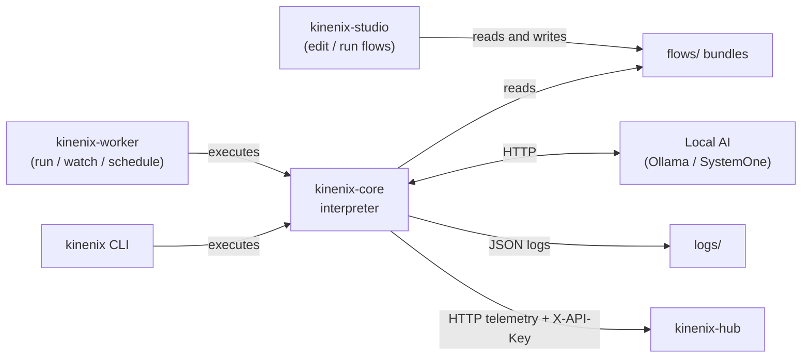
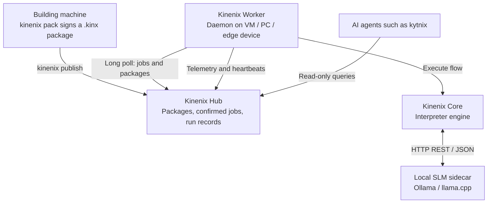
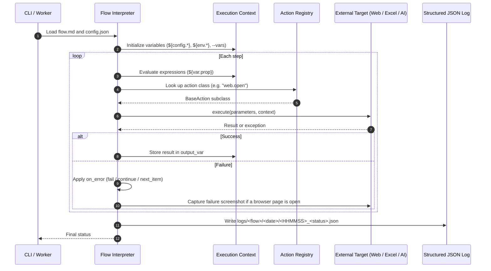

# Architecture

This document describes how Kinenix is structured: its principles, modules, execution pipeline, AI integration, and the planned distributed architecture. It separates what exists today from the target design. For delivery status and priorities, see [roadmap.md](roadmap.md).

---

## 1. Core Principles

- **Local AI-Native:** Designed for on-device Small Language Models (SLMs) running on CPU (e.g. Qwen 2.5, Llama 3.2 via Ollama, llama.cpp, or ONNX). AI powers extraction and decision steps in flows with no cloud token costs and no business data leaving the network.
- **Deterministic first, agentic second:** Flows execute deterministically step by step. AI is used inside explicit actions (`ai.*`) or as an observer, never as a hidden replacement for flow logic.
- **Zero-license Office dependency:** Spreadsheet processing uses file-level libraries (`openpyxl`, `pandas`). Microsoft Excel or Microsoft 365 is never required.
- **Business-first telemetry:** Logs and dashboards report business outcomes (transactions, hours saved, cost saved), not only stack traces.
- **Free, unlimited workers:** No per-bot licensing. Workers run on any PC, VM, or edge device such as a Raspberry Pi.
- **Flows as code:** A flow is a Markdown file (`flow.md`) versioned in Git. A deployed package (`.kinx`) is a signed zip of the same files, not an opaque binary.
- **Extensible in Python:** New actions are Python classes registered with the action registry.

---

## 2. Modules

| Module | Role | Current implementation | Target |
| :--- | :--- | :--- | :--- |
| **`kinenix-core`** | Flow interpreter, variable evaluator, action plugins, `kinenix` CLI | Python 3.12+, Pydantic, Playwright, openpyxl, pandas | Same |
| **`kinenix-worker`** | Runs flows unattended on target machines | CLI with `run`, `watch`, `schedule`, `daemon`; optional separate copy of the bundle per run (`--sandbox`, not isolation) | Long-poll client that receives confirmed jobs and signed flow packages from the Hub (1.5.0) |
| **`kinenix-studio`** | Flow authoring and debugging | FastAPI backend + React/Vite web UI: flow discovery, editing, validation, run | Tauri desktop shell, persistent browser sessions, element picker, live debugger |
| **`kinenix-hub`** | Central monitoring and control | FastAPI + SQLAlchemy (SQLite default); receives heartbeats and telemetry over HTTP; web dashboard; API key auth | Job dispatch and flow delivery over long polling (1.5.0), PostgreSQL, ROI dashboard |

### Current Data Flow



### Target Architecture



---

## 3. Execution Pipeline (`kinenix-core`)



Key implementation files:
- Interpreter, error handling, retry and fallback: `kinenix-core/kinenix/engine/interpreter.py`
- Expression evaluation (no `eval`): `kinenix-core/kinenix/engine/evaluator.py`
- `flow.md` compiler: `kinenix-core/kinenix/engine/markdown.py` (spec: [flow_markdown_spec.md](flow_markdown_spec.md))
- Log writer and telemetry upload: `kinenix-core/kinenix/engine/logger.py` (format: [logging.md](logging.md))

Flows are organized as self-contained project bundles; see [project_bundles.md](project_bundles.md).

---

## 4. AI Integration

AI runs as a **decoupled sidecar**, only in flow actions. The Hub calls no model: the cause and fix of a failure are written by the worker's own rules (`engine/action_errors.py`, `engine/web_errors.py`), and agents such as [kytnix](https://github.com/kinenix/kytnix) read them from the Hub. `kinenix-core` stays lightweight and can run every non-AI flow without any ML runtime installed.

| Where | What it does | Implementation |
| :--- | :--- | :--- |
| Flow actions | `ai.prompt` (JSON-constrained prompts), `ai.extract` (structured fields from text or images), `ai.decide` | Ollama and OpenThai-SystemOne over HTTP (`kinenix-core/kinenix/actions/ai_*.py`) |

See [actions_reference.md](actions_reference.md) for action parameters and [rpa-challenge-ocr in kinenix/examples](https://github.com/kinenix/examples/tree/main/rpa-challenge-ocr) for an end-to-end example.

Planned: self-healing selectors, a Studio copilot for natural-language flow authoring, and SLM diagnosis sent to LINE notifications.

---

## 5. Hub and Worker Communication

**Today:** workers push telemetry and heartbeats to the Hub over HTTP (`POST /api/v1/telemetry`) with the worker key; see [hub.md](hub.md). A run record carries both machine fields (status, counts, error codes) and a Markdown report (`report_md` in `v_runs`) that people and AI agents read.

**Planned for 1.5.0** (decided 2026-11-12 and 2026-11-14, replacing a WebSocket protocol planned before): the worker keeps one long-poll request open to the Hub (`GET /api/v1/jobs/next`), so it opens no port. The answer is a job a person confirmed on the dashboard, for a flow already on the worker that its owner allowed, or a signed flow package to install. Workers report runs as today. Details: [design/agent-interface.md](design/agent-interface.md), section 14, and [design/flow-deploy.md](design/flow-deploy.md).

---

## 6. GitOps Deployment (Planned)

1. **Author:** Build and tune flows locally with the CLI or `kinenix-studio`.
2. **Version:** Commit `flow.md`, `subflows/`, `config/`, and assets to Git.
3. **Validate:** CI runs `pytest` and flow schema validation on every pull request.
4. **Release:** `kinenix pack` builds a signed `.kinx` package of a version, and workers install it from a file or, from 1.5.0, from the Hub ([design/flow-deploy.md](design/flow-deploy.md)).

---

## 7. Repository Layout

```text
Kinenix/
├── kinenix-core/            # Runtime engine and CLI (kinenix)
│   ├── kinenix/
│   │   ├── actions/     # Web, Excel/CSV, file, HTTP, email, logic, flow, AI actions
│   │   ├── engine/      # Interpreter, evaluator, flow.md compiler, logger
│   │   └── models/      # Pydantic flow and context models
│   └── tests/
├── kinenix-worker/          # Unattended runner and triggers (kinenix-worker)
├── kinenix-studio/          # FastAPI backend (kinenix-studio) + frontend/ (React/Vite)
├── kinenix-hub/    # Central telemetry server and dashboard
├── flows/               # Project bundles; @shared/ holds reusable subflows
├── schemas/             # JSON schemas for flows and execution logs
├── docs/                # Documentation (index: docs/README.md)
├── logs/                # Execution logs (git-ignored)
├── .agents/rules/       # Engineering rules for AI assistants
└── AGENTS.md            # Entry point for AI assistants
```
